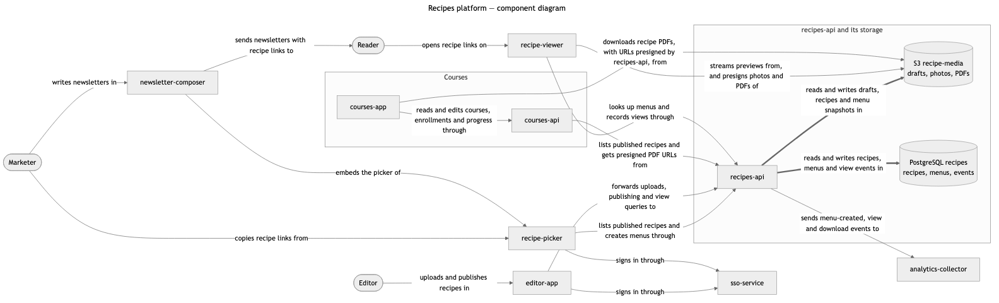
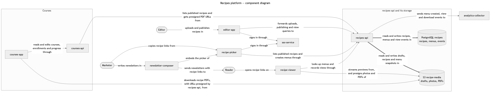

<p align="center">
  
</p>

# Mermaid's Comb

Mermaid's Comb rewrites a [Mermaid](https://mermaid.js.org) flowchart so that Mermaid's own
layout engine, dagre, draws it with as few edge crossings as it can. It first solves for the
best layered drawing with a constraint solver, then makes dagre reproduce that drawing. It
changes only what Mermaid treats as layout: the order of declarations, the length of links
(`-->` to `--->`), and, when nothing else works, one invisible edge (`A ~~~ B`) with a comment
saying why. Nodes, edges, labels, arrows, subgraphs and styles stay exactly as written, and the
tool checks that before it writes anything.

## Why the name

The mermaid has combed her hair for as long as she has been drawn.

- **Medieval and heraldic mermaids** hold a comb in one hand and a mirror in the other; the comb
  is her attribute, the way the keys are Saint Peter's.
- **Heinrich Heine, *Die Lorelei* (1824).** The maiden on the Rhine rock "kämmt ihr goldenes
  Haar … mit goldenem Kamme": she combs her golden hair with a golden comb, and the boatmen
  below forget the reef.
- **T. S. Eliot, *The Love Song of J. Alfred Prufrock* (1915).** "I have seen them riding seaward
  on the waves / Combing the white hair of the waves blown back." Mermaids combing lines of water
  straight is close to what this tool does to edges.
- **Disney's *The Little Mermaid* (1989).** Ariel finds a fork, is told by Scuttle that it is a
  "dinglehopper" for straightening hair, and combs her hair with it at dinner.

Mermaid's Comb is that fork: a tool built for something else (forcing an exact solver's answer
onto dagre) used to comb the tangles out of Mermaid's diagrams.

## What it does

The samples in [`mermaid_comb/samples`](mermaid_comb/samples), measured on an Apple-silicon Mac:

| Sample | Before: crossings / edges under nodes / label collisions | After | Time |
|---|---|---|---|
| [`crossing.mmd`](mermaid_comb/samples/crossing.mmd): two apps, two services | 1 / 0 / 1 | 0 / 0 / 0 | 2 s |
| [`learning.mmd`](mermaid_comb/samples/learning.mmd): 15 nodes, 18 edges, 2 groups | 3 / 3 / 3 | 0 / 0 / 0 | 4 s |
| [`recipes.mmd`](mermaid_comb/samples/recipes.mmd): 14 nodes, 18 edges, 2 groups | 3 / 2 / 1 | 0 / 0 / 0 | 32 s |

`recipes.mmd` before:



and after. One invisible edge, `CoursesApi ~~~ Marketer`, was needed; the drawing is wider
because a crossing-free layout needed more ranks:



## Install

Requirements: Python 3.11 or later, [uv](https://docs.astral.sh/uv/) (or pipx), and Node.js 22.12
or later with npm.

```bash
uv tool install git+https://github.com/walkingpendulum/mermaids-comb
mermaid-comb setup
```

To install a fixed release instead of the latest `main`, add its tag:
`uv tool install git+https://github.com/walkingpendulum/mermaids-comb@v0.1.0`. Releases, what
changed in each, and the versioning rules are in [`CHANGELOG.md`](CHANGELOG.md). Run
`mermaid-comb setup` after changing versions; it reuses the installed runtime when the release
pins the same Mermaid.

`setup` installs the pinned Mermaid, dagre-d3-es and Puppeteer with `npm ci`, downloads
Puppeteer's pinned headless Chrome, and builds the traced Mermaid copy, all under
`$XDG_CACHE_HOME/mermaid-comb` (default `~/.cache/mermaid-comb`, about 400 MB). It does not touch
any global Node or Chrome install.

## Usage

```bash
mermaid-comb solve diagram.mmd -o combed.mmd   # comb a flowchart
mermaid-comb check diagram.mmd other.svg       # count crossings, edges under nodes, label collisions
mermaid-comb search diagram.mmd -o best.mmd    # fallback: best of shuffled declaration orders
mermaid-comb parity                            # verify the pinned Mermaid and the patch (see VENDORED.md)
```

`solve` logs each stage to stderr and lists any defect left. Options:

| Option | Default | Meaning |
|---|---|---|
| `--max-slack` | 3 | spare ranks the ideal layout may use when one spare rank leaves crossings |
| `--budget` | 1000 | declaration orders tried per search |
| `--workers` | 4 | order-replay processes run in parallel (Node only; one Chrome in total) |
| `--max-renders` | 400 | real renders allowed while placing labels |

Exit codes, for `solve` and `check` alike: `0` no defects, `1` defects remain (for `solve`, the
output is written), `2` unusable input or a failure (nothing written).

`solve` needs dagre pinned in the front matter (`config: layout: dagre`) and an acyclic diagram.
Edges must have the form `A -->|label| B` (`-->`, `==>`, `-.->`, `---`, `~~~`, with or without a
label). It refuses chained edges (`A --> B --> C`), `&` groups, nested subgraphs, two edges
between the same pair of nodes, and edges to a subgraph. For such a diagram, `search` renders
`--trials` (default 100) seeded shuffles of the declaration order, each node and edge staying in
its subgraph, and keeps the one with the fewest defects; it proves nothing, but it accepts
anything except chained edges and `&` groups.

## How it works

1. **The ideal drawing.** [OR-Tools CP-SAT](https://developers.google.com/optimization/cp/cp_solver)
   assigns every node a rank (a column in `LR`, a row in `TB`) and every rank a left-to-right
   order, so that every arrow points forward, each subgraph stays one contiguous box, and the
   edge crossings, then the edges crossing a box border, then the total edge length are
   minimal. The model uses Mermaid's own box rules: a box reaches half a rank past its first and
   last member, and an edge touching a group runs inside its box. It first allows one spare rank
   beyond the longest path and, if that leaves crossings, up to `--max-slack`. The count is
   optimal within that height; a zero is final.
2. **Forcing dagre.** Each link's length is set to its span in the ideal drawing, which leaves
   dagre's ranker no other optimum. dagre's ordering, though, is a barycenter heuristic that
   re-sorts every rank, so the declaration order matters only through ties. The tool reads
   dagre's internal layered graph from a traced copy of Mermaid ([`VENDORED.md`](VENDORED.md)),
   replays dagre's `order()` in Node at 1–2 ms per try, and searches declaration orders until
   dagre lands on an optimal order. When no declaration order gets there, it tries one invisible
   edge at a time, shortest first.
3. **Labels.** With the labels back, real renders judge order and length moves, using the same
   crossing, edge-under-node and label-collision checks as `mermaid-comb check`. A move is
   accepted only when the rendered defect count drops.

The result is deterministic: the same input gives a byte-identical output. The renderer runs
Chrome with its sandbox and blocks every request except its own page and Mermaid's files, so a
label such as `` cannot make it fetch anything.

## Limits

- The layout is measured with Mermaid 11.16.0. Other Mermaid versions, other fonts, or another
  renderer (GitHub uses its own Mermaid build) can place boxes differently; run
  `mermaid-comb check` on the surface people will read, or look at it.
- "Optimal" means optimal among drawings at most `--max-slack` ranks longer than the longest
  path, under the box rules above. Crossings at curves that dagre's spline routing adds on its
  own are caught by the rendered check, not by the solver.
- Large diagrams take longer: the ideal-drawing model grows with nodes × ranks, and the
  invisible-edge search with the number of node pairs.

## Development

```bash
poetry install
poetry run mermaid-comb setup
poetry run pytest
```

[`VENDORED.md`](VENDORED.md) explains how to move to a newer Mermaid.
Releases are cut with [`.claude/skills/release`](.claude/skills/release/SKILL.md), which
both people and coding agents can follow.

## License

MIT, see [`LICENSE`](LICENSE). `setup` installs these at the versions in the lock file:
Mermaid (MIT), dagre-d3-es (MIT), Puppeteer (Apache-2.0) and its Chrome for Testing build;
OR-Tools (Apache-2.0) and click (BSD-3-Clause) come from PyPI.
